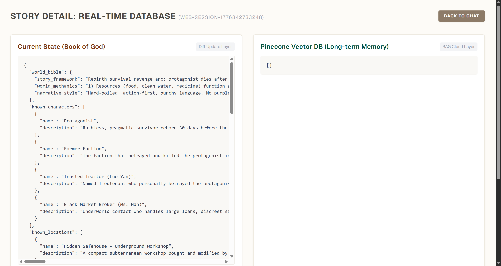
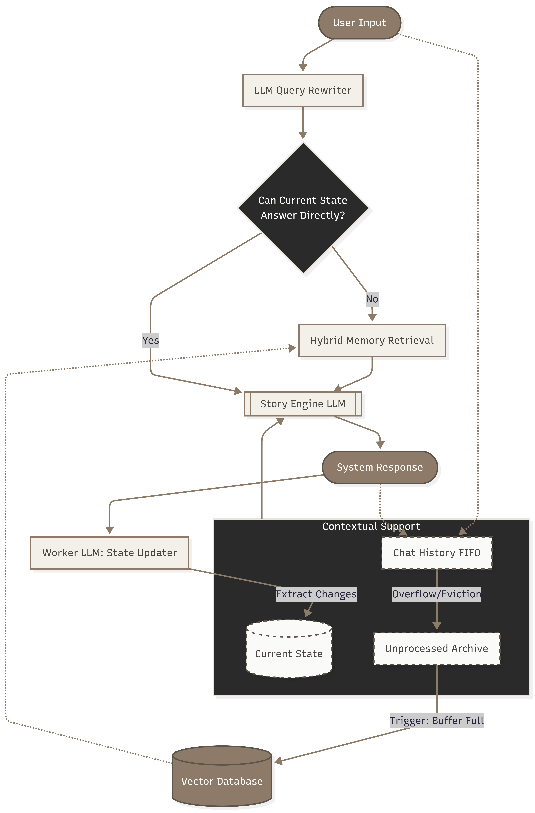

# 📖 Story AI — Long-Horizon Narrative Engine with Hybrid Memory Retrieval

> An open-world text adventure built to stay coherent over long play sessions. It uses a dual-track memory architecture: a state machine for the current world state, and hybrid BM25 + vector retrieval over summarized history. Evaluated on a machine-played 100-round story.

**[Live Demo](https://story-ai-ray.vercel.app/)** · Next.js · LangChain.js · Pinecone · Upstash Redis · GPT-5-mini & GPT-4o-mini

## Screenshot

<div align="center">
  
</div>

<br />

<details>
  <summary><b>🔍 Check more screenshots (Home, New Universe, Detail)</b></summary>
  <p align="center">
    
    <br /><i>Universe Hub</i><br /><br />
    
    <br /><i>World Creation</i><br /><br />
    
    <br /><i>Global State Monitor</i>
  </p>
</details>

---

## Version History

**v2 — Oct 2026 (evaluation-driven redesign).** I benchmarked my own design decisions on a machine-played 100-round story and reversed three of them:
- Replaced vector-only tier search with BM25 + vector hybrid retrieval.
- Removed the intent short-circuit router.
- Rewrote the writer prompt for memory fidelity.

Details and numbers are in [Key Engineering Decisions](#key-engineering-decisions); scripts are in [scripts/eval](scripts/eval).

**v1 — Mar 2026 (initial release).** Dual-track memory with entity-filtered vector "tier search", and an LLM router that skipped retrieval when it judged the state sufficient.

---

## The Core Problem

LLM-powered story games break down at scale. After ~20 turns, models forget earlier plot points. After ~100 turns, context windows overflow. After ~1000 turns, the world loses coherence entirely.

Naive RAG pipelines solve the context overflow problem but fail at exact object recall. Standard semantic similarity is often too "fuzzy" to reliably retrieve specific entities, leading to "entity drift" where critical plot objects vanish or transform.

This project is my attempt to engineer around all three failure modes simultaneously.

---

## Architecture: Dual-Track Parallel Memory

Rather than a single memory strategy, the system runs two independent tracks in parallel after every turn:

### Track 1 — Global State Machine

After the story generator LLM (gpt-5-mini) finishes generating a response, a background Worker LLM (gpt-4o-mini) runs independently of the main story generation. It reads the latest dialogue and extracts **only what changed** — a structured `StateDiff` validated against a Zod schema:

```typescript
// Example diff extracted after "I pick up the ancient sword"
{
  updated_characters:[{name:"player",description:"A young man from the Shire holds the ancient sword"}],
  added_items:[{name:"Ancient Sword of Angels",description:"A magical sword made by angels that glows in the dark."}],
  inventory_added: ["Ancient Sword of Angels"],
  state_summary:"The player picked up the Ancient Sword of Angels."
}
```

This diff is merged into `currentState` in Redis. The state table stays bounded regardless of play length, and every future generation gets the full world state as a constraint without any growing overhead.

**Why this matters:** Separating state extraction from story generation means the main LLM never has to "remember" facts — they're always injected as structured ground truth.

### Track 2 — Memory Lifecycle

Chat history is maintained as a FIFO queue in Redis. 

1. **Sliding Window** — recent turns are kept in memory for immediate context.
2. **Unprocessed Archive** — turns that overflow the sliding window are stored here.
3. **Semantic Chunking** — when the buffer hits threshold, text is split with **context overlap between chunks** to prevent semantic fragmentation at boundaries. Fed into LLM to generate a dense summary and entities involved in the chunk.
4. **Vectorization → Pinecone** — dense narrative embeddings stored with metadata (turn range, location, characters and items involved, importance flags).
5. **Retrieval** — every turn, the system retrieves relevant chunks with hybrid BM25 + vector search and feeds them into the story generator LLM.

**Why this matters:** Separating memory into sliding window and long-term memory allows the system to maintain both immediate context and long-term coherence without overflowing the context window.

System Architecture Diagram:

<div align="center">
  
</div>
---

## Key Engineering Decisions

### Hybrid Retrieval (BM25 + vector, RRF) — v2, Oct 2026

Every turn runs two retrievers over the session's memory chunks and merges them with weighted Reciprocal Rank Fusion:

- **Vector:** the player's raw input is embedded and searched in Pinecone. It starts in parallel with the LLM query rewriter, so it adds no latency after rewriting.
- **BM25:** the raw input plus the rewriter's output (pronouns replaced with entity names, entities appended) is scored with Okapi BM25 over the chunk summaries. The summaries are kept in Redis and scored in memory per request; a session has tens to hundreds of chunks.
- **Fusion:** `score = 1/(60 + rank_vector) + 4/(60 + rank_bm25)` over the top 10 of each list; the top 10 fused chunks go into the prompt.

**How I got here.** The first version used vector-only "tier search": an entity-filtered vector query topped up with an unfiltered one. I assumed BM25 would fail because frequent entity names flatten IDF. Then I tested that on a machine-played 100-round story (44 chunks, 88 recall questions, half reusing the chunk's wording and half paraphrased; see [scripts/eval](scripts/eval)):

- The premise held only for core characters: the protagonist appears in 95% of chunk summaries (IDF 0.06 vs 2.3 for a typical event word). It is largely an artifact of the summarizer replacing pronouns with names.
- BM25 still matched or beat tier search. Removing entity terms from the BM25 query *hurt* it, so the entities were still useful.
- The entity filter barely filtered: on average 77% of chunks passed it, so tier search behaved like plain vector search.
- Vector search won exactly where wording diverged (e.g. "jacket" vs "coat"); BM25 won where it matched. The two were complementary.

**Tuning.** Tuning 9 parameters on 40 questions overfit badly (0.78 → 0.60 MRR on held-out questions). I switched to grouped cross-validation to decide *how much* to tune: only the fusion weights and each retriever's input earned their keep; BM25's own k1/b/IDF stayed at defaults. The chosen point sits on a plateau (k anywhere in 1–100, BM25 weight 3–10).

| Retriever | MRR@10 | Hit@5 | Hit@5 (paraphrased) |
|---|---|---|---|
| Tier search (v1) | 0.49 | 0.66 | 0.61 |
| BM25 only | 0.66 | 0.81 | 0.64 |
| **Hybrid (v2, deployed)** | **0.67** | **0.88** | **0.77** |

Tier search and BM25-only have no tuned parameters, so they are scored directly on all 88 questions. The hybrid numbers are out-of-sample: 4-fold cross-validation grouped by source chunk, repeated 25 times, with the configuration re-chosen on each training split. Scored on the same questions it was tuned on, the hybrid would read 0.70 / 0.91 / 0.84; I report the lower numbers. One story and 88 questions make this directional evidence, not a rigorous benchmark.

### Removed: Intent Short-Circuit — v2, Oct 2026

The first version asked an LLM router before every retrieval: *"Can the current state + recent history answer this without going to the DB?"* If yes, retrieval was skipped to save latency.

I measured it on a machine-played 100-round story ([scripts/eval](scripts/eval)) and removed it:
- It skipped retrieval on **37 of 40 recall questions**. For **32** of those, an LLM judge found the answer was *not* in the state or recent history, so the writer model had to make up the past.
- For ordinary action commands, it short-circuited only **4 of 100** turns. That saved ~0.6s on 4% of turns, not the ~30% I had assumed.

The router was inverted: questions about the past looked "answerable" because their entities appear in the state, while actions almost always went to retrieval. Every turn now retrieves.

### Memory Fidelity in the Writer Prompt — v2, Oct 2026

Retrieval was not the only failure point. In an end-to-end check (88 recall questions; the story model answers, an LLM judge compares the answer with the recorded fact), most wrong answers happened even though the right memory *was* in the prompt. The writer prompt was working against it:

- "Only use elements explicitly present in the current state" excluded everything retrieved from long-term memory.
- Retrieved memories were dumped into an unlabeled "Context" line with no instruction on how to use them.
- "No inner thoughts / describe only visible actions" ruled out recalling anything.

The prompt now labels the memory inputs and adds a Memory Fidelity rule. The past is fixed. When the player asks about an earlier event, the writer answers from memory exactly as recorded, or says the protagonist can't recall it. For ordinary actions, memories are used silently as background. That last clause matters: a first version let every action turn insert "Memory: ..." lines.

| Writer prompt | Consistent with the past | Contradicts it |
|---|---|---|
| Before | 48 / 88 | 37 / 88 |
| **After** | **78 / 88** | **10 / 88** |

31 answers improved and 1 got worse. On ordinary action turns, length and style are unchanged. Caveat: the first draft of the new prompt was also run on these 88 questions. The follow-up edit only targeted action turns, but the set is not fully unseen.

### LLM Selection Rationale

| Role | Model | Reason |
|------|-------|--------|
| Story Writer | gpt-5-mini | Capability in story generation, long-context narrative coherence, fast streaming, cost-efficient |
| State Worker | gpt-4o-mini | Even cheaper than gpt-5-mini, and reliable structured JSON output via native JSON mode |

---

## Known Limitations & What I'd Build Next

I documented these honestly because I think identifying architectural ceilings is as important as building the system.

**Current issue 1:** All 10 retrieved chunks are assigned equal significance in the final prompt. In practice, their actual relevance to the player's immediate intent can vary significantly, sometimes introducing narrative noise that distracts the writer model.

**Next: Agentic RAG with Document Grading**
Introduce a self-reflection loop post-retrieval: a fast grading model evaluates each retrieved chunk's relevance before it enters the prompt. Active filtering instead of passive retrieval.

> ⚠️ **Risk:** An intermediate grading LLM adds ~150–300ms TTFT. For a real-time game, that's meaningful. Possible mitigation: run grading only when retrieval confidence score is below a threshold, not on every turn.

**Current issue 2:** Current state table is a global table, which can lead to a large state table as the number of turns increases. 

**Next: State Hydration on Demand**
Spatial state decoupling — only hydrate sub-states relevant to the player's current scene or active event, not the full world state on every call.

> ⚠️ **Risk:** It's hard to distinguish whether a state is relevant to the scene. Some items may have a hidden-trigger linked to a world state in a far-off region. Moreover, to know what sub-states are relevant, the system must first understand the player intent. However, to fully comprehend the intent, the LLM often requires the context provided by those sub-states. This creates a chicken-and-egg problem.

**Current issue 3:** Recall on my benchmark is near its ceiling (95% of answers in the top 10), but the benchmark is easy. It is one 100-round story, and its questions are generated from chunk summaries, so it cannot catch details the summarizer dropped. Of the 8/88 questions that miss the top 5, 7 are paraphrases with synonym gaps ("jacket" vs "coat", "leg" vs "thigh"). The rest are repeated events: the protagonist is shot by the same enemy in 5+ different chunks, and the question carries no time cue.

**Next: improving recall, in priority order**
1. **A harder benchmark first.** Use a 300+ round story, questions written from the original text rather than summaries, vague references ("what did that man give me?"), and temporal questions ("the first time I was shot"). Without it, further tuning is noise; tuning on 40 questions already overfit once.
2. **Document expansion at write time.** The chunk-extraction LLM call also emits synonyms and likely player questions, appended to the BM25 text. This targets the synonym misses with zero query-time latency and no extra LLM call.
3. **Query expansion in the rewriter.** The existing rewriter call also returns 3–5 alternative phrasings for the BM25 query. No extra call.
4. **Temporal anchoring.** The rewriter extracts time cues ("first", "at the bank", "before the fight"), which boost or filter chunks by turn range. This targets repeated events.
5. **Deeper candidates + re-ranking.** Take the top 30 from each retriever and let a cross-encoder or a small LLM pick the final 10. 7 of the 8 misses have the right chunk ranked 11–22 in one list. Cost: +200–500 ms. This is also the first step of the Agentic RAG grading above.
6. **Diversity (MMR).** 27/44 chunks have a near-duplicate, so the top 10 can fill up with versions of the same fight.
7. **Small-to-big retrieval.** Index the original text at sentence level and return the parent chunk, recovering details that summaries drop.

---

## Tech Stack

| Layer | Technology |
|-------|-----------|
| Frontend | Next.js (App Router), React, Tailwind CSS |
| Backend | Serverless Node.js with streaming |
| AI Orchestration | LangChain.js |
| State & Cache | Upstash Redis |
| Long-term Memory | Pinecone Vector DB |
| Validation | Zod schema |

---

## Running Locally

```bash
git clone https://github.com/Ray-gyr/storyAI
cd storyAI
npm install

# Set up environment variables
cp .env.example .env
# Fill in: OPENAI_API_KEY, PINECONE_API_KEY, UPSTASH_REDIS_REST_URL, UPSTASH_REDIS_REST_TOKEN

npm run dev
```

The Pinecone index must exist before the first run: name `story-memory`, dimension 1536 (`text-embedding-3-small`), metric cosine.

---

## What I Learned

Building this forced me to think carefully about **token budget as a first-class engineering constraint** — every architectural decision (state diffs instead of full state, sliding window instead of full history) was made to reduce tokens per request without sacrificing coherence.

The biggest insight: **memory in LLM systems isn't a storage problem, it's a retrieval precision problem.** Having the right context matters more than having all the context.
